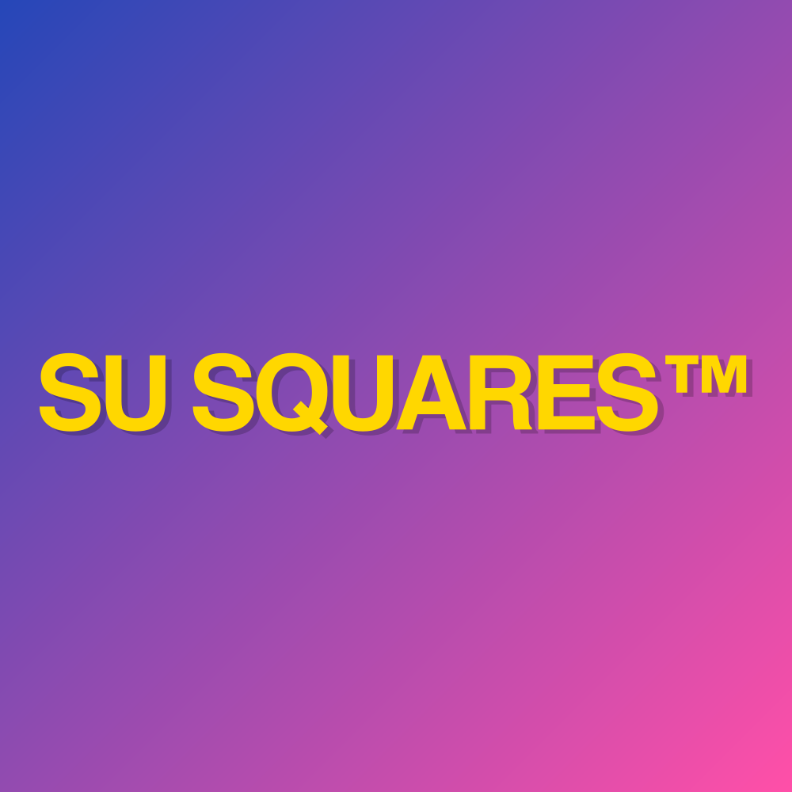

# Su Squares website

This source code runs the Su Squares website at <https://TenThousandSu.com>

## How it works

The square on this site is updated by <https://github.com/su-squares/update-script> other stuff is updated by commits into this repo and the site is published live using GitHub Pages. So commits immediately publish to the site.

## Contributing

Thank you for contributing to the project.

If you want to edit the [FAQ](/faq.md), stop reading. Just edit that file, I think you can figure it out.

For other files, please read the existing HTML. You will see that we try to keep it simple. No jQuery, avoid includes if possible. Minify images. We are designing the website for my grandmom, everything needs to be super clear.

This project is conservatively managed and the maintainer will accept few major changes, if any. The separate website https://tools.tenthousandsu.com/ is much more open for experimentation.

## Personalization

The personalize page enumerates the connected wallet's Squares on Ethereum mainnet, 20 at a time, and submits the
selected titles, links and 10-by-10 images in one underlay batch transaction at 0.001 ETH per Square, plus gas.
The batch page includes agent instructions and accepts tab-separated Square number, title, link and RGB hex data.
It validates the format and live ownership before enabling confirmation, and checks ownership again before sending.

Run the personalization regression tests with `node --test tests/personalization.test.mjs`.

## Maintenance

The project administrator does these tasks each month. If they are 3 or more months late, send an issue or a pull request.

1. Review the external actions in [.github/workflows](.github/workflows). Move an action to a new major version when its changelog shows that version is safe. Actions from the `actions` organization need that short review. [`ruby/setup-ruby`](https://github.com/ruby/setup-ruby) stays on the `@v1` tag, which tracks the current release.
2. Check the [`github-pages` gem](https://github.com/github/pages-gem/releases) and [Node.js LTS](https://github.com/nodejs/Release). This site builds with Ruby 3.3 and the unpinned `github-pages` gem. The preview workflow uses Node.js 24. The chain loader uses the Node.js version in [update-script `.nvmrc`](https://github.com/su-squares/update-script/blob/main/.nvmrc), which is `lts/*`. [Wrangler](https://github.com/cloudflare/workers-sdk) stays on major 4.

## References

1. Use title case only for proper nouns. Su Squares is a proper noun.
2. These maintenance tasks follow [best practices documented in project-template](https://github.com/fulldecent/project-template), release v1.3.0. This site publishes from `main` on every push, so it does not use that template's release workflow.
3. This project is released under the [MIT license](LICENSE).
